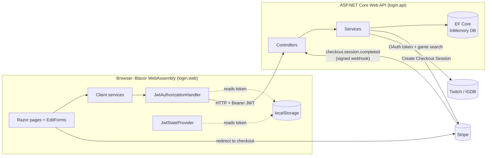

<p align="center">
  
</p>

# NeonVault: a full-stack C# web app (Blazor WebAssembly + ASP.NET Core)

A complete web application built **entirely in C#**: a Blazor WebAssembly frontend talking to an ASP.NET Core Web API, with JWT authentication, role-based authorization, an EF Core data layer with a many-to-many relationship, and two real third-party integrations: **Stripe Checkout + webhooks** for payments and the **IGDB (Twitch) API** for game data.

The "product" is a small game library: users register, log in, browse games and other players, and buy games through Stripe. Admins can add new games, and the cover art is fetched automatically from IGDB. The product is not the point, though. This project is my end-to-end exercise in the pieces that make up the skeleton of a real web application, and how they fit together in the .NET ecosystem.

> This is my first full-stack project. It isn't meant to be production software. It's meant to show that I understand how a modern web app is wired from the browser to the database to external services, and that I can build each layer myself.

---

## Highlights

- **One language, both sides of the wire.** C# in the browser (Blazor WASM) and on the server (ASP.NET Core), sharing the same patterns: DTOs, interfaces, DI and async/await.
- **Real authentication flow.** The backend mints JWTs with BCrypt-verified credentials. The frontend decodes the token, builds the user's `ClaimsPrincipal`, checks expiry and attaches the token to every request through a delegating handler.
- **Real payments.** A Stripe Checkout session is created server-side with metadata. Stripe calls a **signature-verified webhook** on `checkout.session.completed`, and only then is the game added to the user's account.
- **Real external data.** IGDB cover art is fetched through a Twitch OAuth client-credentials token that's **cached in memory** until shortly before it expires.
- **Defensive by design.** Every service returns `(result, error)` tuples instead of letting exceptions leak. The UI shows meaningful messages instead of crashing, and the API returns correct status codes.

---

## Tech stack

| Layer | Technology |
|---|---|
| Frontend | Blazor WebAssembly (.NET 10), `AuthenticationStateProvider`, `EditForm` + DataAnnotations, `IJSRuntime` |
| Backend | ASP.NET Core Web API (.NET 10), controllers, JWT Bearer authentication |
| Data | Entity Framework Core (InMemory provider), LINQ |
| Security | JWT (HMAC-SHA256), BCrypt password hashing, role-based `[Authorize]`, CORS policy |
| Payments | Stripe.net: Checkout Sessions + webhook signature verification |
| External API | IGDB / Twitch OAuth2 (client credentials), `IHttpClientFactory`, `IMemoryCache` |

---

## Architecture



**Purchase flow**

1. The user clicks **Buy Game**. The Blazor client calls `POST /api/checkout/create-checkout` with its JWT.
2. The API checks the user exists and doesn't already own the game, then creates a Stripe Checkout Session with `UserId` and `GameTitle` in its metadata.
3. The browser is redirected to Stripe's hosted checkout page.
4. After payment, Stripe calls `POST /api/webhook/stripe`. The API **verifies the signature**, reads the metadata and links the game to the user (many-to-many).
5. The user lands on `/dashboard/success`. The game now appears on their profile.

---

## What this project demonstrates

| Concept | Where to look |
|---|---|
| ASP.NET Core fundamentals: middleware pipeline, controllers, routing, configuration | [`login.api/Program.cs`](login.api/Program.cs), [`login.api/controllers/`](login.api/controllers) |
| Object-oriented design: interfaces, encapsulation, models vs. DTOs | [`login.api/services/`](login.api/services), [`login.api/data/`](login.api/data), [`login.api/dto/`](login.api/dto) |
| Dependency injection on **both** client and server (scoped services, typed `HttpClient`s, transient handlers) | [`login.api/Program.cs`](login.api/Program.cs), [`login.web/Program.cs`](login.web/Program.cs) |
| EF Core + LINQ (`Include`, `FirstOrDefaultAsync`, `Any`, projections) | [`login.api/services/IDashboardService.cs`](login.api/services/IDashboardService.cs) |
| Many-to-many relationship (`AppUser` ⇄ `Game` via EF Core skip navigations) | [`login.api/data/AppUser.cs`](login.api/data/AppUser.cs), [`login.api/data/Game.cs`](login.api/data/Game.cs) |
| Asynchronous programming end to end (`async`/`await` from UI event → HTTP → DB) | Everywhere |
| Separation of concerns: Controller → Service (interface + implementation) → Data, mirrored on the client | [`login.api/`](login.api), [`login.web/services/`](login.web/services) |
| REST endpoints with correct status codes (`200`, `201 Created` + location, `400`, `401`, `404`) | [`login.api/controllers/`](login.api/controllers) |
| Defensive integration with external services (try/catch, status checks, null checks, error tuples) | [`login.api/services/IigdbService.cs`](login.api/services/IigdbService.cs), [`login.web/services/`](login.web/services) |
| Frontend ↔ backend communication with DTO mapping (entities never leave the API) | [`login.api/dto/`](login.api/dto), [`login.web/dto/`](login.web/dto) |
| Security basics: BCrypt hashing, no passwords in responses, `[Authorize]`, `[Authorize(Roles = "Admin")]` | [`login.api/services/IAuthService.cs`](login.api/services/IAuthService.cs), [`login.api/controllers/DashboardController.cs`](login.api/controllers/DashboardController.cs) |
| JWT on the server: minting tokens with claims (id, name, role, avatar), registering JWT Bearer auth | [`login.api/services/IAuthService.cs`](login.api/services/IAuthService.cs), [`login.api/Program.cs`](login.api/Program.cs) |
| JWT on the client: decoding the payload into a `ClaimsIdentity`, expiry check, login/logout notifications | [`login.web/MiddleWare/JwtStateProvider.cs`](login.web/MiddleWare/JwtStateProvider.cs) |
| `DelegatingHandler` that attaches `Authorization: Bearer` to outgoing requests | [`login.web/MiddleWare/JwtAuthorizationHandler.cs`](login.web/MiddleWare/JwtAuthorizationHandler.cs) |
| Browser storage via JS interop (`IJSRuntime` → `localStorage`) | [`login.web/services/IAuthClientService.cs`](login.web/services/IAuthClientService.cs) |
| Blazor forms and validation (`EditForm`, `DataAnnotationsValidator`, `[Compare]`, `[MinLength]`) | [`login.web/Pages/Auth/`](login.web/Pages/Auth), [`login.web/Models/`](login.web/Models) |
| Route protection and role-based UI (`AuthorizeRouteView`, `[Authorize]` pages, `<AuthorizeView Roles="Admin">`) | [`login.web/App.razor`](login.web/App.razor), [`login.web/Pages/Dashboard/Games.razor`](login.web/Pages/Dashboard/Games.razor) |
| Blazor component organization: code-behind `partial` classes, scoped CSS isolation (`.razor.css`), layouts, route constraints (`{gameId:int}`), `[CascadingParameter]` auth state | [`login.web/Pages/`](login.web/Pages), [`login.web/Layout/`](login.web/Layout) |
| Typed `HttpClient`s through `IHttpClientFactory` on both sides (no `new HttpClient()` sockets leaking) | [`login.web/Program.cs`](login.web/Program.cs), [`login.api/Program.cs`](login.api/Program.cs) |
| CORS policy so only the Blazor origin can call the API from a browser | [`login.api/Program.cs`](login.api/Program.cs) |
| Modern C#: nullable reference types, `required` members, tuple returns, string interpolation, LINQ projections | Everywhere |
| Stripe Checkout + webhook signature verification | [`login.api/services/ICheckoutService.cs`](login.api/services/ICheckoutService.cs), [`login.api/services/IWebhookService.cs`](login.api/services/IWebhookService.cs) |
| IGDB integration with an OAuth token cached in `IMemoryCache` | [`login.api/services/IigdbService.cs`](login.api/services/IigdbService.cs) |
| Database seeding (admin account + starter games) | [`login.api/Program.cs`](login.api/Program.cs) |
| Configuration and secrets through `IConfiguration` (environment variables / user secrets) | [`login.api/Program.cs`](login.api/Program.cs), [Configuration](#2-configure-secrets) |

---

## Features

- **Register** with username, password (validated + confirmed) and an avatar.
- **Log in** to receive a JWT. The session survives page reloads and expires automatically.
- **Dashboard** with a games catalogue, a players list and a profile page.
- **Game page:** see who owns a game and buy it through Stripe if you don't.
- **User page:** see a player's library with cover art.
- **Admin only:** add a new game by title. Cover art is pulled from IGDB automatically.
- **Payment outcome pages** for success and cancellation.

---

## API overview

| Method | Route | Auth | Description |
|---|---|---|---|
| `POST` | `/api/auth/register` | Public | Create an account (`201 Created`) |
| `POST` | `/api/auth/login` | Public | Returns a JWT |
| `GET` | `/api/users` | User | List users with their games |
| `GET` | `/api/user/{id}` | User | Get one user |
| `GET` | `/api/games` | User | List games with their owners |
| `GET` | `/api/game/{id}` | User | Get one game |
| `POST` | `/api/games` | **Admin** | Add a game (cover art fetched from IGDB) |
| `POST` | `/api/checkout/create-checkout` | User | Create a Stripe Checkout Session, returns its URL |
| `POST` | `/api/webhook/stripe` | Stripe signature | Handles `checkout.session.completed` |

---

## Getting started (localhost)

### Prerequisites

- [.NET 10 SDK](https://dotnet.microsoft.com/download)
- A [Stripe](https://dashboard.stripe.com/register) account in **test mode** and the [Stripe CLI](https://docs.stripe.com/stripe-cli)
- A [Twitch developer application](https://dev.twitch.tv/console/apps) (Client ID + Client Secret) for the IGDB API

### 1. Clone

```bash
git clone https://github.com/NSanin-dev/NeonVault.git
cd NeonVault
```

### 2. Configure secrets

The API reads five values through `IConfiguration`:

| Key | Value |
|---|---|
| `Jwt:SecretKey` | Any long random string (at least 32 characters) |
| `Stripe:SecretKey` | Your Stripe **test** secret key (`sk_test_...`) |
| `Stripe:WebhookSecret` | The `whsec_...` printed by the Stripe CLI (see step 3) |
| `IGDB:ClientId` | Your Twitch application's Client ID |
| `IGDB:SecretKey` | Your Twitch application's Client Secret |

The simplest option is **.NET user secrets**, which keeps them out of the repository:

```bash
cd login.api
dotnet user-secrets init
dotnet user-secrets set "Jwt:SecretKey" "<a-long-random-string>"
dotnet user-secrets set "Stripe:SecretKey" "sk_test_..."
dotnet user-secrets set "Stripe:WebhookSecret" "whsec_..."
dotnet user-secrets set "IGDB:ClientId" "<twitch-client-id>"
dotnet user-secrets set "IGDB:SecretKey" "<twitch-client-secret>"
```

Environment variables also work; use `__` in place of `:`, for example `Stripe__SecretKey`.

> **Stripe API version:** this project uses Stripe.net 53, which expects events in API version `2026-09-30.endive`. If your account's default API version is older, webhook verification fails with a `400`. Upgrade the version in the Stripe Dashboard (Workbench → API version) so the two match.

### 3. Run it: three terminals

**Terminal 1: Stripe webhook listener**

```bash
stripe login
stripe listen --forward-to http://localhost:5082/api/webhook/stripe --events checkout.session.completed
```

Copy the `whsec_...` it prints into `Stripe:WebhookSecret` **before** starting the API. It stays the same between runs on the same machine.

**Terminal 2: API** (runs on `http://localhost:5082`)

```bash
cd login.api
dotnet run
```

**Terminal 3: Blazor client** (runs on `http://localhost:5087`)

```bash
cd login.web
dotnet run
```

Open **http://localhost:5087**.

### 4. Try it

1. **Register** a new account and log in, or use the seeded admin account `EmperorOfMcDonal` (password in the seed block of [`login.api/Program.cs`](login.api/Program.cs)).
2. Open **Games**, pick a game and click **Buy Game**.
3. Pay with Stripe's test card **`4242 4242 4242 4242`**, any future expiry date and any CVC.
4. You're redirected to the success page. The Stripe CLI shows `[200]`, and the game now appears on your profile.
5. Log in as the admin to add new games by title. Cover art is fetched from IGDB.

> The database is **in-memory**: restarting the API resets all users and purchases back to the seed data.

---

## Project structure

```
NeonVault/
├── login.api/                  ASP.NET Core Web API
│   ├── controllers/            HTTP layer: routing, status codes, auth attributes
│   ├── services/               Business logic (interface + implementation per service)
│   ├── data/                   EF Core DbContext and entities (AppUser ⇄ Game)
│   ├── dto/                    Request/response contracts
│   └── Program.cs              DI, JWT, CORS, pipeline, seeding
│
└── login.web/                  Blazor WebAssembly client
    ├── Pages/                  Routed pages (Auth, Dashboard, GameViewer, UserViewer, ...)
    ├── Layout/                 Main/auth layouts and navigation
    ├── services/               Typed HttpClient services mirroring the API
    ├── MiddleWare/             JwtStateProvider + JwtAuthorizationHandler
    ├── Models/                 Form models with validation attributes
    ├── dto/                    Contracts shared in shape with the API
    └── Program.cs              DI, HttpClient registration, auth setup
```

---

## How this was built

All of the **C# logic on both ends is mine**: the API, services, EF Core model, JWT handling, Stripe and IGDB integrations, and the Blazor client, state provider and handlers. I also wrote the HTML markup and the base CSS. The more advanced styling (animations, gradients and polished component CSS) was produced with the help of an AI coding tool. I chose to focus my own effort on the architecture and the .NET side, which is what this project is meant to demonstrate.

---

## Known limitations and what I'd do next

I kept the scope deliberately small so I could focus on the integrations. In a production version, I would:

- Replace the InMemory provider with **SQL Server or PostgreSQL** and EF Core migrations.
- Move hard-coded URLs (API base address, Stripe success/cancel URLs, CORS origin) into configuration.
- Store prices in the database instead of a fixed checkout amount.
- Take the buyer's identity from the **JWT claims** on the server instead of trusting the request body.
- Make the webhook **idempotent** and log events, so Stripe retries are handled safely.
- Add refresh tokens, and HttpOnly cookies instead of `localStorage`.
- Add unit and integration tests (xUnit + `WebApplicationFactory`).
- Containerize with Docker and deploy (Azure App Service / Static Web Apps).

---

## About me

I'm a developer and entrepreneur focused on the .NET ecosystem. This project is the foundation; more complex ones are on the way. If you're looking for someone to build with, or want to talk about a project, reach out:

- **GitHub:** [@NSanin-dev](https://github.com/NSanin-dev)
- **Email:** [epicdecent69@gmail.com](mailto:epicdecent69@gmail.com)
